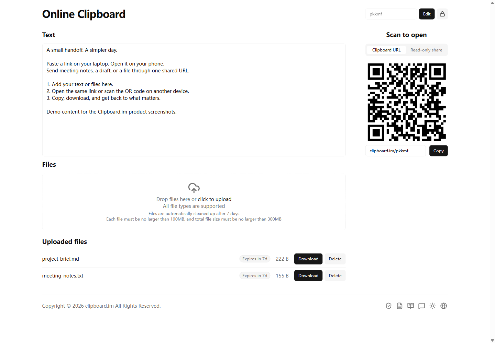
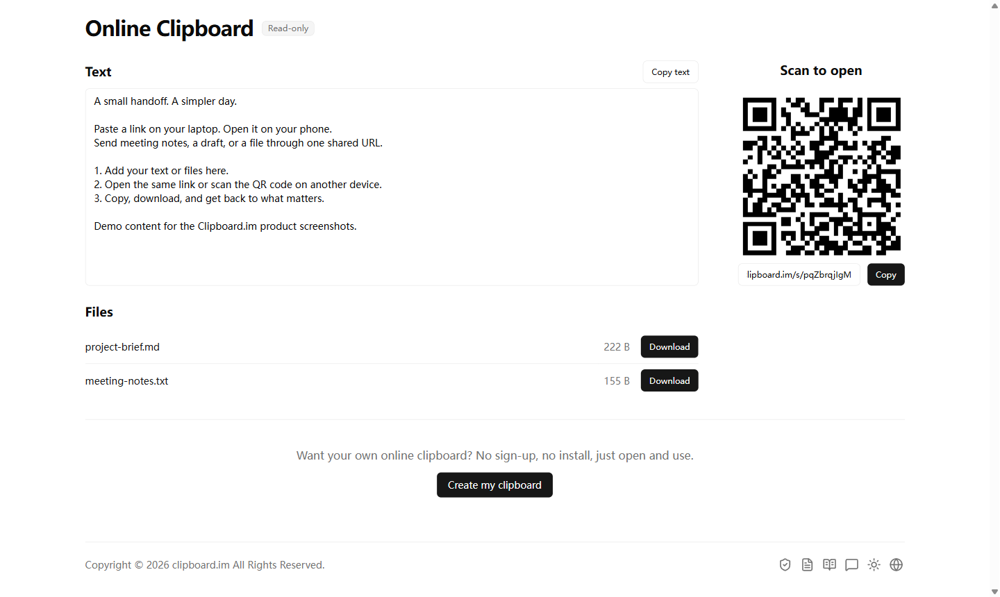
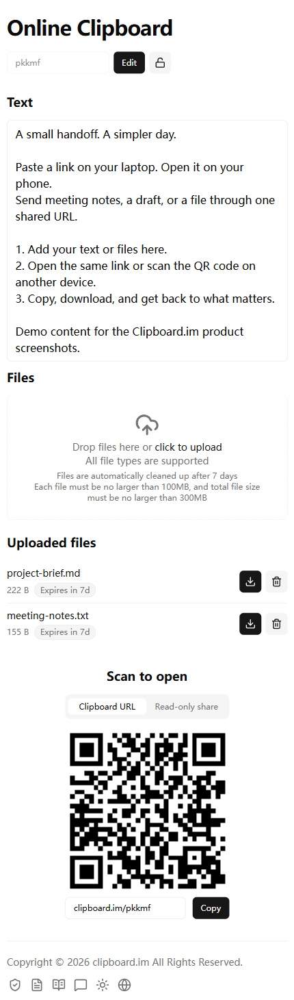

# Clipboard.im

### Đến thiết bị tiếp theo chỉ bằng một liên kết.

Clipboard.im là bảng nhớ tạm trực tuyến gọn nhẹ để chuyển văn bản, liên kết và tệp giữa các thiết bị. Dán trên máy tính, mở trên điện thoại hoặc chia sẻ với người khác — ngay trong trình duyệt, không cần đăng ký hay cài ứng dụng.

**[Mở Clipboard.im →](https://clipboard.im/vi)**

[English](../README.md) · [简体中文](../docs/README.zh-CN.md) · [繁體中文](../docs/README.zh-TW.md) · [日本語](../docs/README.ja.md) · [한국어](../docs/README.ko.md) · [Español](../docs/README.es.md) · [Português (Brasil)](../docs/README.pt-BR.md) · [Français](../docs/README.fr.md) · [Deutsch](../docs/README.de.md) · [Русский](../docs/README.ru.md) · [हिन्दी](../docs/README.hi.md) · [Bahasa Indonesia](../docs/README.id.md) · **Tiếng Việt** · [ไทย](../docs/README.th.md) · [Türkçe](../docs/README.tr.md) · [Italiano](../docs/README.it.md) · [Polski](../docs/README.pl.md) · [Nederlands](../docs/README.nl.md) · [Українська](../docs/README.uk.md) · [Filipino](../docs/README.fil.md) · [Bahasa Melayu](../docs/README.ms.md) · [বাংলা](../docs/README.bn.md)

## Cho những lần chuyển dữ liệu nhỏ hằng ngày

- **Dùng ngay.** Không cần tài khoản, đăng nhập, ứng dụng hay tiện ích trình duyệt.
- **Một địa chỉ, nhiều thiết bị.** Mở cùng địa chỉ trên điện thoại, máy tính bảng hoặc máy tính. Có thể đổi tên cho dễ nhớ.
- **Văn bản và tệp cùng một chỗ.** Dán ghi chú hoặc liên kết, kéo thả tệp rồi sao chép hay tải xuống trên thiết bị khác.
- **Quét mã để tiếp tục.** Mở bảng nhớ tạm trên điện thoại bằng mã QR, không cần gõ địa chỉ.
- **Chọn cách chia sẻ.** Đặt mật khẩu hoặc tạo liên kết chỉ đọc để người nhận xem và tải xuống mà không sửa hay xóa. Liên kết chia sẻ có thể có mật khẩu riêng và có thể thu hồi.
- **Phù hợp cách bạn sử dụng.** Giao diện thích ứng, chế độ sáng và tối, hỗ trợ 22 ngôn ngữ.

## Khi nào hữu ích

Chuyển liên kết từ điện thoại sang laptop. Gửi tài liệu sang máy tính dùng chung để in. Chia sẻ ghi chú cuộc họp và tệp đính kèm với đồng nghiệp qua liên kết chỉ đọc.

## Bắt đầu với ba bước

1. Mở trang web để nhận địa chỉ bảng nhớ tạm.
2. Dán văn bản hoặc tải tệp lên. Nhấp ra ngoài ô văn bản để lưu thay đổi.
3. Mở cùng địa chỉ trên thiết bị khác hoặc quét mã QR. Sao chép văn bản hay tải tệp xuống.

## Xem giao diện thực tế

Ảnh chụp trang web thực tế với nội dung mẫu vào ngày 18 tháng 10 năm 2026. Ảnh di động dùng khung nhìn trình duyệt kích thước điện thoại. Giao diện trong ảnh là tiếng Anh.

**Chia sẻ chỉ đọc: xem và tải xuống, không có thao tác chỉnh sửa.**

Điện thoại: cùng bảng nhớ tạm trong trình duyệt di động.

## Giới hạn và quyền truy cập

Trang web hiện ghi **100 MB mỗi tệp**, **300 MB mỗi bảng nhớ tạm** và tự động dọn tệp sau **7 ngày**. Kiểm tra giới hạn mới nhất tại khu vực tải lên. Hãy giữ bản sao tệp quan trọng; đây là công cụ chuyển dữ liệu tạm thời.

Nếu không đặt mật khẩu, bất kỳ ai biết địa chỉ đều có thể truy cập và thay đổi nội dung. Dùng liên kết chỉ đọc khi người khác chỉ cần xem hoặc tải xuống. Hãy giữ kín mật khẩu.

---

Kho lưu trữ này chứa phần giới thiệu sản phẩm và ảnh chụp màn hình. Sử dụng dịch vụ trực tuyến tại Clipboard.im.

[Góp ý và đề xuất](https://github.com/zijietang/clipboard.im/issues) · [Clipboard.im](https://clipboard.im/vi)
