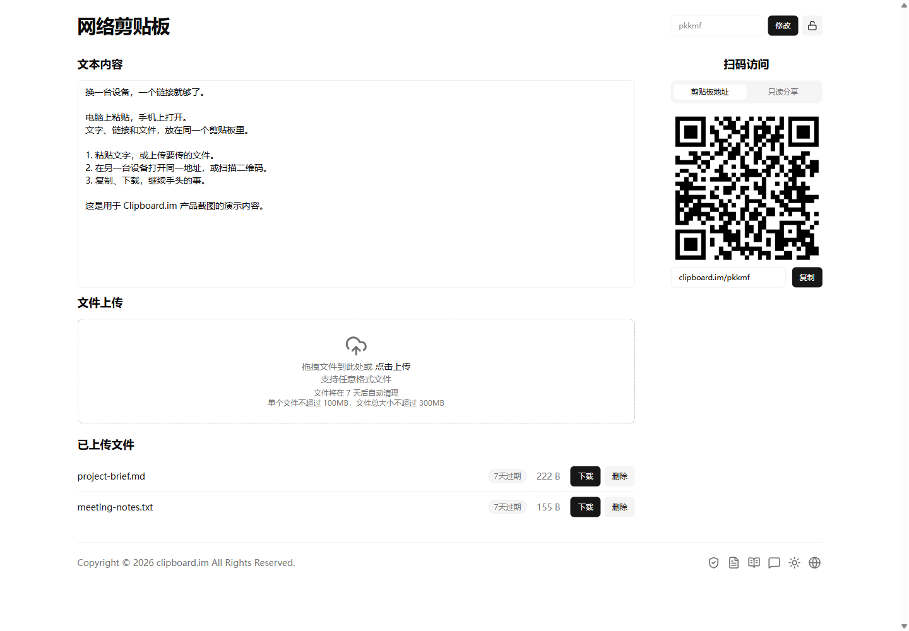

# Clipboard.im · 即时剪贴板

### 换一台设备，一个链接就够了。

即时剪贴板 Clipboard.im 是一个轻量的在线剪贴板，帮你在手机、电脑和平板之间传递文字、链接与文件。电脑上粘贴，手机上打开；给自己临时中转，也能分享给别人。打开浏览器就能用，无需注册、登录或安装应用。

**[立即使用 Clipboard.im →](https://clipboard.im/zh-CN)**

[English](../README.md) · **简体中文** · [繁體中文](../docs/README.zh-TW.md) · [日本語](../docs/README.ja.md) · [한국어](../docs/README.ko.md) · [Español](../docs/README.es.md) · [Português (Brasil)](../docs/README.pt-BR.md) · [Français](../docs/README.fr.md) · [Deutsch](../docs/README.de.md) · [Русский](../docs/README.ru.md) · [हिन्दी](../docs/README.hi.md) · [Bahasa Indonesia](../docs/README.id.md) · [Tiếng Việt](../docs/README.vi.md) · [ไทย](../docs/README.th.md) · [Türkçe](../docs/README.tr.md) · [Italiano](../docs/README.it.md) · [Polski](../docs/README.pl.md) · [Nederlands](../docs/README.nl.md) · [Українська](../docs/README.uk.md) · [Filipino](../docs/README.fil.md) · [Bahasa Melayu](../docs/README.ms.md) · [বাংলা](../docs/README.bn.md)

## 为那些「只想传一下」的时刻而做

- **打开就能用。** 不用注册账号，不用登录，也不用安装 App 或浏览器扩展。
- **一个地址，多台设备。** 在另一台设备打开相同的剪贴板地址即可访问，也可以自定义一个更好记的名字。
- **文字、文件放在一起。** 粘贴链接和笔记，拖入文件，再到另一台设备复制或下载。
- **扫一扫，继续操作。** 用手机扫描页面二维码，省去手动输入网址。
- **按需要选择分享方式。** 给剪贴板设置密码，或生成只读链接，让对方查看文字、下载文件，无需开放编辑和删除。只读链接还可单独设密码、随时停止分享。
- **适配日常使用习惯。** 支持手机与桌面布局、浅色与深色主题，以及 22 种界面语言。

## 这些时候尤其顺手

把手机上的链接转到电脑；到打印店临时传一份文档；给同事分享会议笔记与附件，只让对方查看和下载。

## 三步开始使用

1. 打开网站，获得一个剪贴板地址。
2. 粘贴文字或上传文件；编辑文字后，点击输入框外部保存。
3. 在另一台设备打开同一地址，或扫描二维码，即可复制文字、下载文件。

## 看看实际界面

截图来自真实网站，使用演示内容，拍摄于 2026 年 10 月 18 日。手机截图使用移动端浏览器视口；下方只读分享和手机截图为英文界面。

**只读分享：接收者可以查看和下载，页面不提供编辑与删除操作。**

手机端：在手机浏览器中访问同一个剪贴板。

## 容量、保留期限与访问方式

网站当前标示：**单文件 100 MB**、**每个剪贴板合计 300 MB**，文件在 **7 天后自动清理**。最新限制以页面上传区为准。它适合临时中转，重要文件请另外保存。

未设置剪贴板密码时，知道地址的人可以访问和修改内容。只想让别人查看或下载时，请使用只读链接。密码用于控制访问，请妥善保管。

---

本仓库用于展示产品介绍与截图。直接访问 Clipboard.im 即可使用在线服务。

[反馈与建议](https://github.com/zijietang/clipboard.im/issues) · [Clipboard.im](https://clipboard.im/zh-CN)
